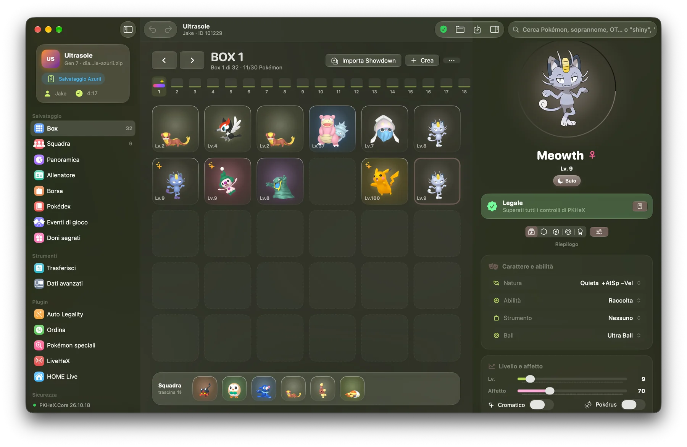
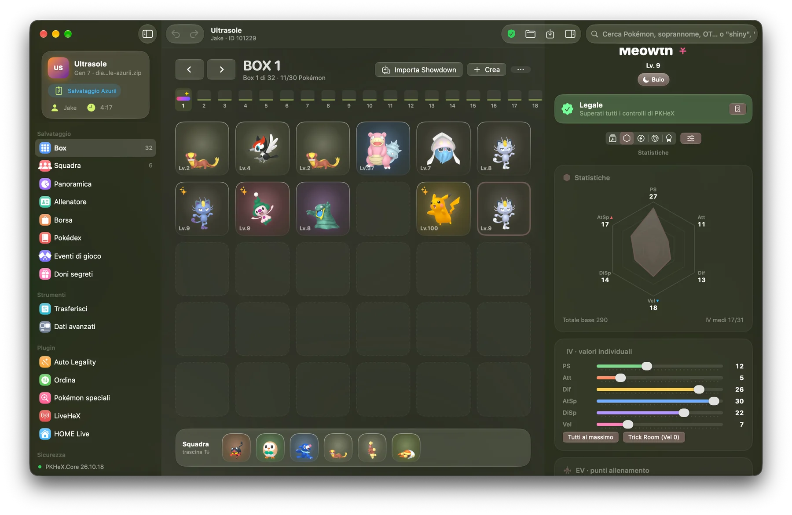
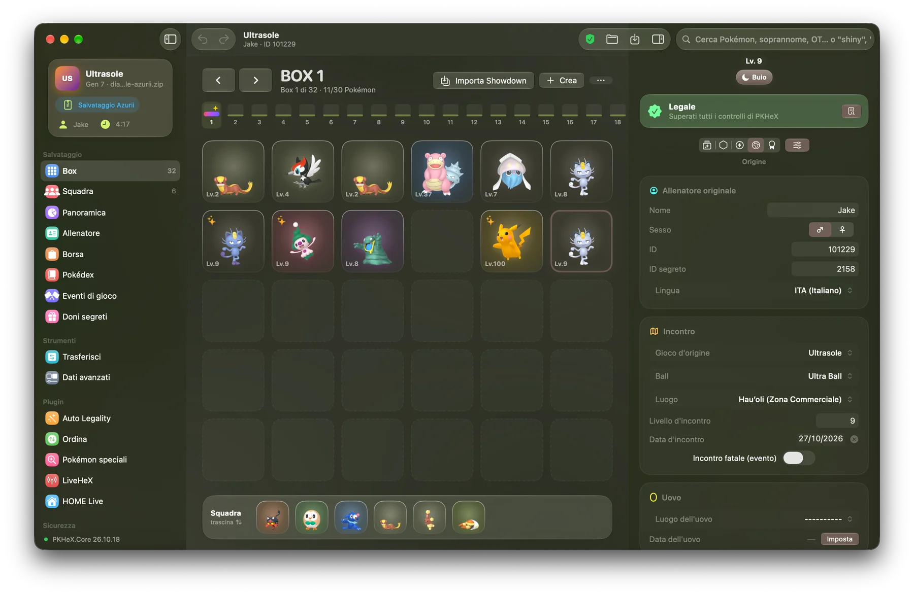
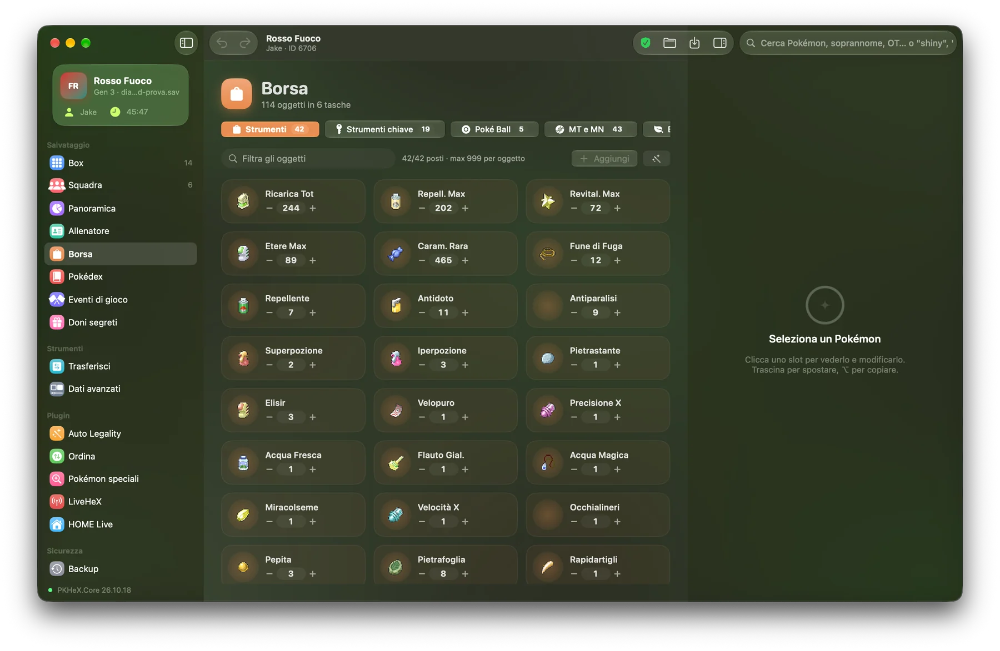
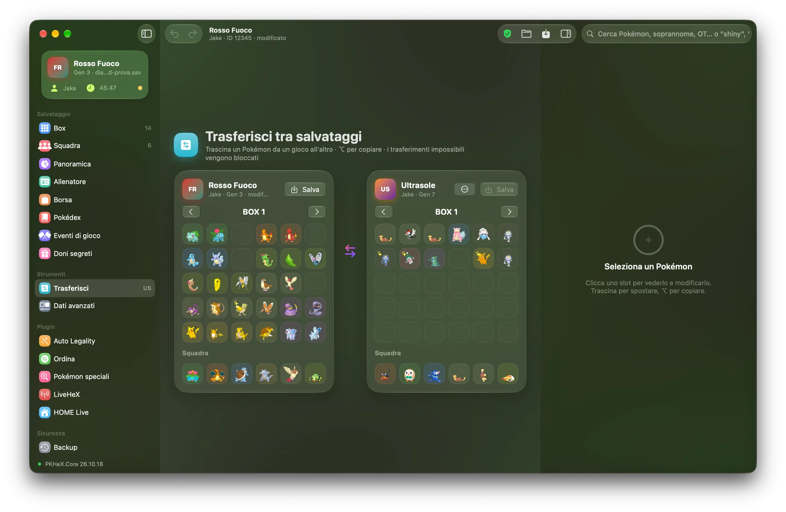
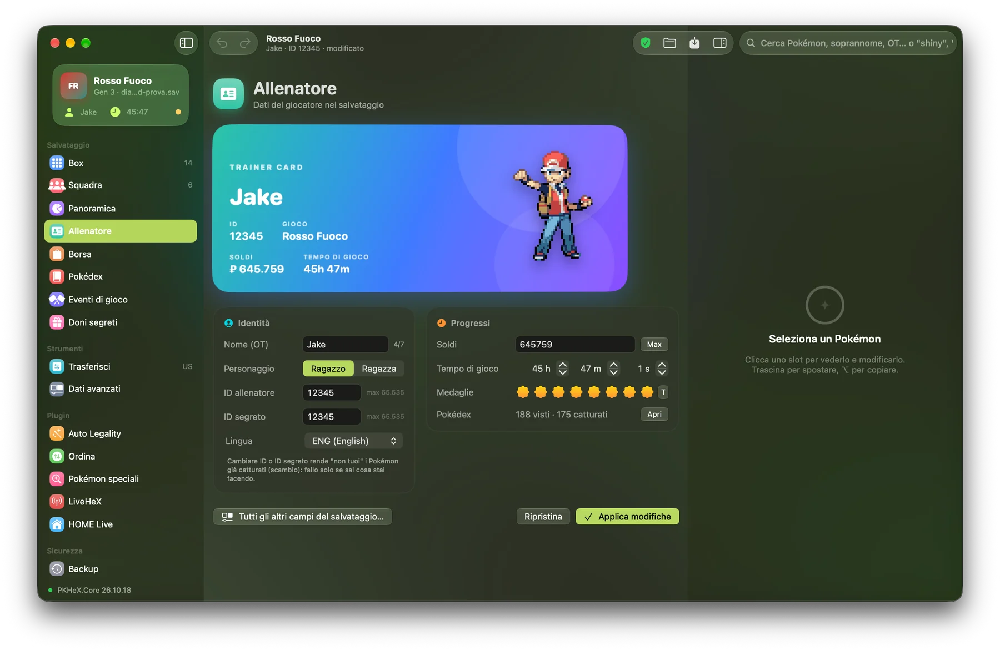
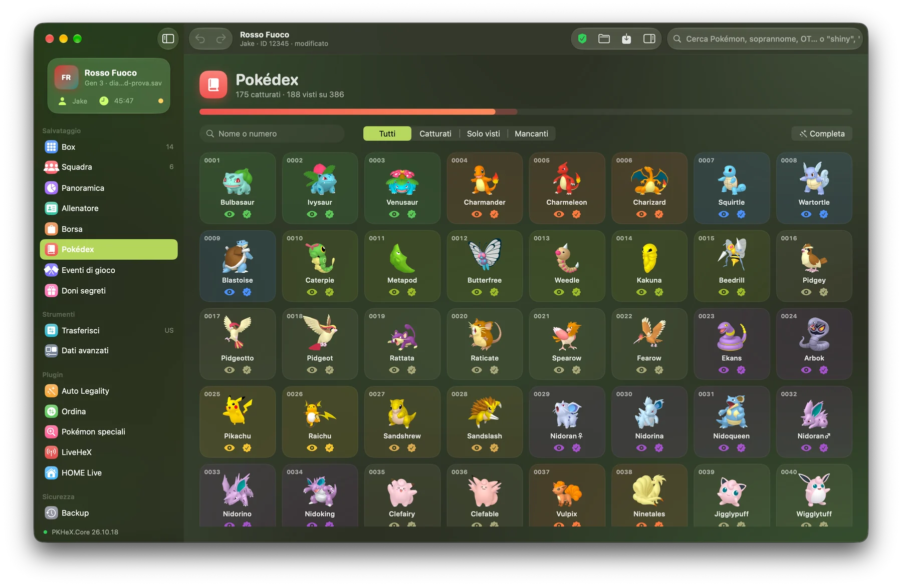
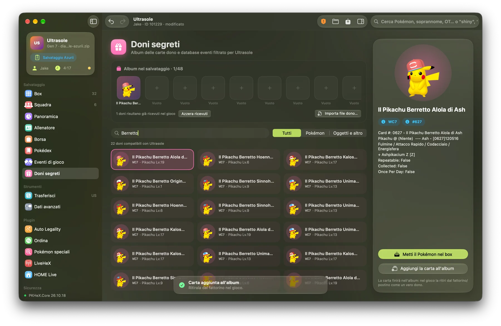
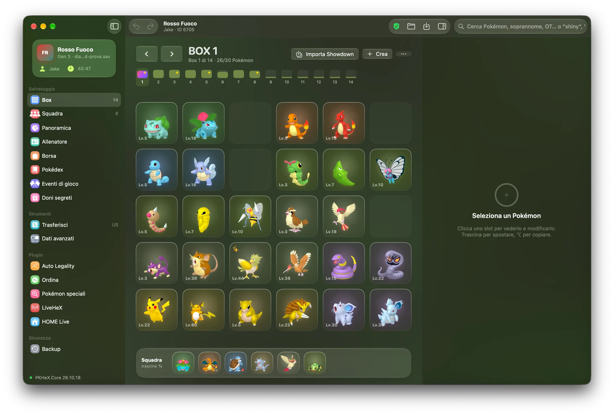

<p align="center">
  
</p>

<h1 align="center">PkMac</h1>

<p align="center">
  <b>Editor di salvataggi Pokémon nativo per macOS, basato su PKHeX.Core</b><br>
  <i>Native Pokémon save editor for macOS, powered by PKHeX.Core</i>
</p>

<p align="center">
  <a href="https://github.com/JakeFrost86/PkMac/releases/latest"></a>
  
  
  
</p>

<p align="center">
  <a href="#-italiano">🇮🇹 Italiano</a> · <a href="#-english">🇬🇧 English</a>
</p>

<p align="center">
  
</p>

---

## 🇮🇹 Italiano

PkMac è un editor di salvataggi Pokémon fatto apposta per il Mac. Sotto c'è **PKHeX.Core**, lo stesso motore di PKHeX, quindi legge e scrive tutti i giochi che supporta PKHeX e applica le stesse regole di legalità. Sopra c'è un'interfaccia SwiftUI con Liquid Glass di macOS 26. I plugin più usati sono già integrati.

Il motore si aggiorna da solo: quando esce una nuova versione di PKHeX.Core, PkMac la scarica, la prova e la attiva senza bisogno di ricompilare l'app.

### Cosa fa

#### Salvataggi
- **Tutti i giochi supportati da PKHeX**, dalla prima generazione a Scarlatto/Violetto e Leggende Z-A: `main`, `.sav`, `.dsv`, `.dat`, `.gci`, `.bin` e i file Pokémon `.pk*`.
- **Salvataggio verificato.** PkMac ricalcola i checksum e rilegge il file appena scritto. Poi confronta box e squadra con quello che c'è in memoria, crea un backup, scrive in modo atomico e controlla il risultato byte per byte.
- **Backup automatici** prima di ogni salvataggio, con una sezione dedicata per ripristinarli.
- **Annulla e Ripeti illimitati** (⌘Z / ⇧⌘Z) per ogni modifica.
- **Controllo di integrità** del salvataggio e **ricerca globale**, anche con le parole chiave «shiny» e «illegale».

#### Box e squadra
- **Drag & drop** tra i box e tra squadra e box. Tieni premuto ⌥ per copiare invece di spostare. Se trascini sopra un box, il box si apre.
- Importa ed esporta file `.pk*`, anche un box intero.
- Rilascia, cura e copia o incolla set Showdown dal menu di ogni Pokémon.
- **Panoramica** del salvataggio con grafici: specie uniche, shiny, uova, Pokémon non legali, tipi più presenti e livelli.

#### Editor del Pokémon
- **Riepilogo:** specie, forma, soprannome, livello, natura, abilità, strumento, ball, teratipo, sesso, shiny, Pokérus, amicizia.
- **Statistiche:** IV ed EV con radar delle statistiche, IV al massimo in un clic.
- **Mosse:** le quattro mosse con i PP, e i suggerimenti di PKHeX.
- **Origine, tutta modificabile:**
  - lingua, gioco d'origine, ball, luogo e livello d'incontro, date;
  - dati dell'uovo, incontro fatale;
  - allenatore originale (nome, sesso, ID e ID segreto) e allenatore attuale;
  - PID ed EC, con il pulsante per rigenerarli.
- **Fiocchi:** tutti i fiocchi e gli emblemi del gioco.
- **Dati avanzati**, con un pulsante a parte: ogni proprietà del Pokémon così come la vede PKHeX.
- **Legalità in tempo reale** con il rapporto completo di PKHeX e il pulsante **Rendi legale**.

#### Creazione e legalità
- **Crea un Pokémon legale** in qualsiasi slot. Prende il nome allenatore, gli ID e la lingua del salvataggio, e usa gli incontri reali del gioco.
- **Rendi legale** un Pokémon o un box intero, con i suggerimenti di PKHeX (mosse, luogo d'incontro, mosse ricordabili) e Auto Legality.
- **Import Showdown** da testo o da pokepast.es, **Pokédex vivente**, Pokémon shiny.

#### Editor del salvataggio
- **Allenatore:** nome, sesso, ID e ID segreto, soldi, tempo di gioco, lingua e medaglie. La scheda mostra lo sprite del personaggio.
- **Borsa:**
  - tutte le tasche, con lo sprite di ogni oggetto e le quantità;
  - aggiunta degli oggetti con ricerca;
  - azioni rapide: tutti gli oggetti, quantità massima, ordinamento, svuota.
- **Pokédex:** visti e catturati per ogni specie, e azioni di massa adatte a ogni gioco, Leggende Arceus compreso.
- **Eventi di gioco:** flag ed eventi con i nomi di PKHeX.
- **Doni segreti:**
  - l'album del salvataggio;
  - il database di tutti i doni distribuiti, filtrato per il gioco aperto;
  - ricezione diretta nel box e importazione dei file dono.
- **Trasferisci tra salvataggi:**
  - apri un secondo salvataggio, anche di un'altra generazione, e trascina i Pokémon da uno all'altro;
  - PkMac li converte per il gioco di destinazione e li adatta al nuovo allenatore;
  - blocca i trasferimenti che il gioco non può davvero ricevere.
- **Dati avanzati del salvataggio:** blocchi di gioco e qualsiasi altro campo, per chi vuole arrivare dove PKHeX arriva.

#### Integrazioni
| Plugin | Autore | In PkMac |
|---|---|---|
| Auto Legality Mod | architdate, kwsch, santacrab2 | Import Showdown e pokepast.es, Pokémon legali, legalizza box, Pokédex vivente, database eventi |
| LiveHeX | santacrab2 / PKHeX-Plugins | Legge e scrive i box del gioco in esecuzione, via sys-botbase (Wi-Fi) o NTR |
| HOME Live | Manu098vm | Mostra i box di Pokémon HOME, li importa nel salvataggio e fa un backup completo |
| PokeFilename | architdate | Nomi personalizzati per i file `.pk` esportati |
| PluginPile | foohyfooh | Ordinamento per Pokédex regionali e Pokémon speciali (Dunsparce a tre segmenti, Tandemaus, Wurmple) |

- **Sprite di [PokeAPI](https://github.com/PokeAPI/sprites):**
  - render di HOME, artwork ufficiale, sprite in pixel e animazioni di Showdown;
  - si scaricano al bisogno e restano in cache.

#### App
- **Italiano e inglese.** Di base l'app segue la lingua di macOS; puoi cambiarla dalla schermata iniziale o dalle Impostazioni.
- **Icone dell'app** alternative e stile degli sprite (3D o 2D).
- **Errori sotto controllo.** Se qualcosa va storto, PkMac mostra l'errore e lo scrive nel registro invece di chiudersi. Il registro si apre da *Aiuto › Mostra il registro degli errori*.

### Screenshot

> **Sprite.** Gli sprite di Pokémon, oggetti e allenatori che vedi nell'app e negli screenshot non sono miei e non fanno parte di PkMac. L'app li scarica al bisogno dal repository pubblico [PokeAPI/sprites](https://github.com/PokeAPI/sprites) (gli sprite degli allenatori da Pokémon Showdown, quelli di oggetti e forme che mancano su PokeAPI dal repository di PKHeX). Tutti i diritti su immagini e personaggi appartengono a Nintendo, Creatures e GAME FREAK.

| | |
|:-:|:-:|
| <br>**Statistiche** | <br>**Origine modificabile** |
| <br>**Borsa** | <br>**Trasferisci tra salvataggi** |
| <br>**Allenatore** | <br>**Pokédex** |
| <br>**Doni segreti** | <br>**Box e squadra** |

### Installazione

Servono **macOS 26** o successivo e un **Mac con Apple Silicon**.

1. Scarica `PkMac.zip` dall'[ultima release](https://github.com/JakeFrost86/PkMac/releases/latest), scompattalo e sposta **PkMac** in *Applicazioni*.
2. PkMac non è firmato con un certificato Apple. La prima volta che lo apri, macOS lo blocca: vai in *Impostazioni di Sistema › Privacy e sicurezza* e scegli **Apri comunque**.

Gli aggiornamenti successivi arrivano direttamente nell'app.

### Aggiornamenti senza ricompilare

PkMac ha un motore separato (`PkMacEngine`, .NET 10) che contiene PKHeX.Core e i plugin. Da *Impostazioni › Aggiornamenti* si gestiscono tre livelli:

1. **PKHeX.Core.** PkMac scarica l'ultima versione da NuGet e la inserisce in una copia del motore. La attiva solo se supera i test di sicurezza: checksum, rilettura e Auto Legality. Può farlo da solo all'avvio.
2. **Motore e plugin.** Ogni giorno una GitHub Action controlla NuGet e i repository dei plugin. Se trova qualcosa di nuovo ricompila il motore, lo prova e lo pubblica come release `engine-*`.
3. **App.** Le release `v*` contengono `PkMac.zip`: l'app si sostituisce e si riavvia da sola.

Se un motore aggiornato non parte, PkMac torna in automatico a quello incluso nell'app.

### Compilare

Servono macOS 26, Xcode 26 e .NET 10 SDK.

```bash
./build.sh            # app + motore -> build/PkMac.app, build/PkMac.zip
./build.sh --install  # e copia in /Applications
```

Per una nuova versione:

1. Scrivi le novità in `release-notes/<versione>.md`.
2. Aumenta `app` in `versions.json`.
3. Fai il push su `main`.

La Action compila e crea la release `v<versione>` con quelle note, `PkMac.zip` e `PkMacEngine-osx-arm64.zip`.

### Crediti e licenza

PkMac è distribuito con licenza **GPLv3**, come PKHeX. PKHeX.Core © Kaphotics e collaboratori. I plugin appartengono ai rispettivi autori, indicati nella tabella. Gli sprite vengono da PokeAPI e non sono distribuiti con PkMac.

Pokémon è un marchio di Nintendo, Creatures e GAME FREAK. PkMac non è affiliato con loro. Non usare Pokémon modificati in lotta o negli scambi con chi non lo sa.

---

## 🇬🇧 English

PkMac is a Pokémon save editor built for the Mac. Under the hood it runs **PKHeX.Core**, the same engine as PKHeX, so it reads and writes every game PKHeX supports and applies the same legality rules. On top sits a SwiftUI interface with macOS 26 Liquid Glass. The most popular plugins come built in.

The engine updates itself: when a new PKHeX.Core is released, PkMac downloads it, tests it and switches to it, with no need to rebuild the app.

<p align="center">
  
</p>

### What it does

#### Saves
- **Every game PKHeX supports**, from Generation 1 to Scarlet/Violet and Legends Z-A: `main`, `.sav`, `.dsv`, `.dat`, `.gci`, `.bin` and `.pk*` Pokémon files.
- **Verified saving.** PkMac recomputes checksums and reads back the file it just wrote. It then compares boxes and party with what is in memory, makes a backup, writes atomically and checks the result byte by byte.
- **Automatic backups** before every save, with a dedicated section to restore them.
- **Unlimited Undo and Redo** (⌘Z / ⇧⌘Z) for every change.
- **Save integrity check** and **global search**, including the keywords "shiny" and "illegal".

#### Boxes and party
- **Drag & drop** between boxes and between party and boxes. Hold ⌥ to copy instead of move. Hovering over a box while dragging opens it.
- Import and export `.pk*` files, including a whole box.
- Release, heal and copy or paste Showdown sets from each Pokémon's menu.
- **Overview** of the save with charts: unique species, shinies, eggs, illegal Pokémon, most common types and levels.

#### Pokémon editor
- **Summary:** species, form, nickname, level, nature, ability, held item, ball, Tera Type, gender, shiny, Pokérus, friendship.
- **Stats:** IVs and EVs with a stat radar, and max IVs in one click.
- **Moves:** the four moves with their PP, plus PKHeX's suggestions.
- **Origin, fully editable:**
  - language, origin game, ball, met location and level, dates;
  - egg data, fateful encounter;
  - original trainer (name, gender, ID and secret ID) and current handler;
  - PID and EC, with a button to reroll them.
- **Ribbons:** every ribbon and mark in the game.
- **Advanced data**, behind its own button: every property of the Pokémon as PKHeX sees it.
- **Live legality check** with PKHeX's full report and a **Make legal** button.

#### Creation and legality
- **Create a legal Pokémon** in any slot. It takes the save's trainer name, IDs and language, and uses the game's real encounters.
- **Make legal** a single Pokémon or a whole box, using PKHeX's suggestions (moves, met location, relearn moves) and Auto Legality.
- **Showdown import** from text or pokepast.es, **living Pokédex**, shiny Pokémon.

#### Save editors
- **Trainer:** name, gender, ID and secret ID, money, play time, language and badges. The card shows the player character's sprite.
- **Bag:**
  - every pouch, with item sprites and quantities;
  - add items with search;
  - quick actions: give all, max quantity, sort, clear.
- **Pokédex:** seen and caught for every species, and bulk actions tailored to each game, Legends Arceus included.
- **Game events:** flags and event values with PKHeX's names.
- **Mystery Gifts:**
  - the save's album;
  - a database of every distributed gift, filtered for the open game;
  - direct receiving into the box and gift file import.
- **Transfer between saves:**
  - open a second save, even from another generation, and drag Pokémon from one to the other;
  - PkMac converts them for the destination game and adapts them to the new trainer;
  - it blocks transfers the game can't actually receive.
- **Advanced save data:** game blocks and any other field, for those who want to go as far as PKHeX goes.

#### Integrations
| Plugin | Author | In PkMac |
|---|---|---|
| Auto Legality Mod | architdate, kwsch, santacrab2 | Showdown and pokepast.es import, legal Pokémon, legalize a box, living Pokédex, event database |
| LiveHeX | santacrab2 / PKHeX-Plugins | Reads and writes the boxes of the running game over sys-botbase (Wi-Fi) or NTR |
| HOME Live | Manu098vm | Shows your Pokémon HOME boxes, imports them into the save and makes a full backup |
| PokeFilename | architdate | Custom names for exported `.pk` files |
| PluginPile | foohyfooh | Regional Pokédex sorting and special Pokémon (three-segment Dunsparce, Tandemaus, Wurmple) |

- **[PokeAPI](https://github.com/PokeAPI/sprites) sprites:**
  - HOME renders, official artwork, pixel sprites and Showdown animations;
  - downloaded on demand and cached.

#### App
- **Italian and English.** By default the app follows the macOS language; you can switch it from the welcome screen or in Settings.
- **Alternative app icons** and sprite style (3D or 2D).
- **Errors under control.** When something goes wrong, PkMac shows the error and writes it to the log instead of quitting. Open the log from *Help › Show the error log*.

### Screenshots

> The screenshots show the app in Italian; switch it to English from the welcome screen.
>
> **Sprites.** The Pokémon, item and trainer sprites you see in the app and in the screenshots are not mine and are not part of PkMac. The app downloads them on demand from the public [PokeAPI/sprites](https://github.com/PokeAPI/sprites) repository (trainer sprites from Pokémon Showdown, item and form sprites missing from PokeAPI from the PKHeX repository). All rights to the images and characters belong to Nintendo, Creatures and GAME FREAK.

| | |
|:-:|:-:|
| <br>**Stats** | <br>**Editable origin** |
| <br>**Bag** | <br>**Transfer between saves** |
| <br>**Trainer** | <br>**Pokédex** |
| <br>**Mystery Gifts** | <br>**Boxes and party** |

### Installation

You need **macOS 26** or later and an **Apple Silicon Mac**.

1. Download `PkMac.zip` from the [latest release](https://github.com/JakeFrost86/PkMac/releases/latest), unzip it and move **PkMac** to *Applications*.
2. PkMac isn't signed with an Apple certificate. The first time you open it, macOS blocks it: go to *System Settings › Privacy & Security* and choose **Open Anyway**.

Later updates arrive directly in the app.

### Updates without rebuilding

PkMac has a separate engine (`PkMacEngine`, .NET 10) that holds PKHeX.Core and the plugins. *Settings › Updates* manages three levels:

1. **PKHeX.Core.** PkMac downloads the latest version from NuGet and drops it into a copy of the engine. It switches to it only if it passes the safety tests: checksums, read-back and Auto Legality. It can do this on its own at launch.
2. **Engine and plugins.** Every day a GitHub Action checks NuGet and the plugin repositories. When something changes it rebuilds the engine, tests it and publishes it as an `engine-*` release.
3. **App.** `v*` releases contain `PkMac.zip`: the app replaces itself and relaunches.

If an updated engine fails to start, PkMac falls back to the one bundled with the app.

### Building

You need macOS 26, Xcode 26 and the .NET 10 SDK.

```bash
./build.sh            # app + engine -> build/PkMac.app, build/PkMac.zip
./build.sh --install  # and copy it to /Applications
```

For a new version:

1. Write the changes in `release-notes/<version>.md`.
2. Bump `app` in `versions.json`.
3. Push to `main`.

The Action builds and publishes the `v<version>` release with those notes, `PkMac.zip` and `PkMacEngine-osx-arm64.zip`.

### Credits and license

PkMac is released under the **GPLv3** license, like PKHeX. PKHeX.Core © Kaphotics and contributors. The plugins belong to their respective authors, listed in the table. Sprites come from PokeAPI and are not distributed with PkMac.

Pokémon is a trademark of Nintendo, Creatures and GAME FREAK. PkMac is not affiliated with them. Don't use edited Pokémon in battles or trades with people who don't know.
