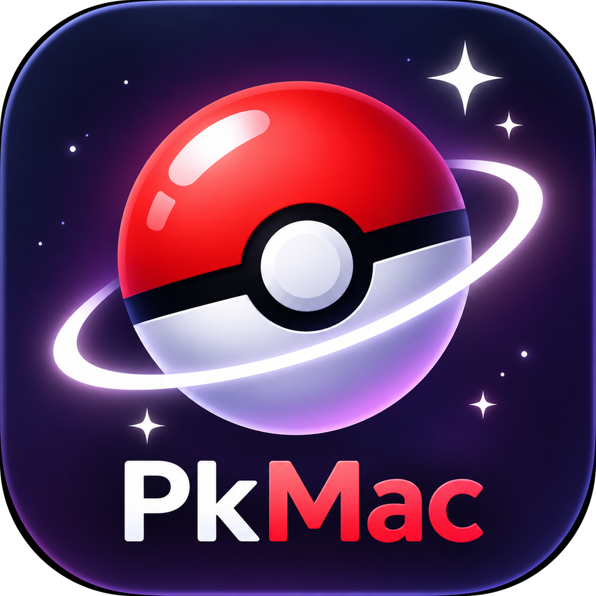

<p align="center">
  
</p>

<h1 align="center">PkMac</h1>
<p align="center"><b>Editor di salvataggi Pokémon nativo per macOS, basato su PKHeX.Core.</b><br>
Interfaccia SwiftUI con Liquid Glass, controllo di legalità in tempo reale, salvataggi verificati e plugin integrati.</p>

---

## Cosa fa

- **Tutti i giochi supportati da PKHeX**: dalla prima generazione a Scarlatto/Violetto e Leggende Z-A (main, .sav, .dsv, .dat, .gci, .bin e file .pk*).
- **Zip di Azurii** – apre direttamente, senza scompattarli, i salvataggi esportati da Azurii (export, slot, copie iCloud, «prima di PKHeX») e i backup completi. Al salvataggio riscrive solo il file del gioco e aggiorna il manifest (`created`, `saveDate`, `editedWith`), così lo zip si reimporta in Azurii così com'è.
- **Box con drag & drop** (⌥ per copiare), squadra, panoramica con grafici, scheda allenatore.
- **Editor completo**: natura, abilità, strumento, ball, teratipo, livello, IV/EV con radar delle statistiche, mosse, origine.
- **Legalità in tempo reale** con rapporto completo e pulsante «Rendi legale».
- **Salvataggio verificato**: PkMac ricalcola i checksum, rilegge il file generato, confronta box e squadra, crea un backup, scrive in modo atomico e verifica byte per byte.
- **Annulla/Ripeti** illimitati (⌘Z / ⇧⌘Z), ricerca globale (anche «shiny» e «illegale»).
- **Sprite di [PokeAPI](https://github.com/PokeAPI/sprites)** (render HOME, artwork ufficiale e animazioni Showdown), scaricati al bisogno e messi in cache.

## Plugin integrati

| Plugin | Autore | In PkMac |
|---|---|---|
| Auto Legality Mod | architdate, kwsch, santacrab2 | Import Showdown e pokepast.es, crea Pokémon legali, legalizza box, Pokédex vivente, database eventi |
| LiveHeX | santacrab2/PKHeX-Plugins | Lettura/scrittura dei box in diretta via sys-botbase (Wi-Fi) o NTR |
| HOME Live | Manu098vm | Visualizza i 300 box di Pokémon HOME, importa nel salvataggio, backup completo |
| PokeFilename | architdate | Nomi personalizzati dei file .pk esportati |
| PluginPile | foohyfooh | Ordinamento per Pokédex regionali, Pokémon speciali (Dunsparce a tre segmenti, Tandemaus, Wurmple) |

## Aggiornamenti senza ricompilare

PkMac ha un motore separato (`PkMacEngine`, .NET 10) che contiene PKHeX.Core e i plugin. Da **Impostazioni › Aggiornamenti**:

1. **PKHeX.Core** – scarica l'ultima versione da NuGet, la inserisce in una copia del motore e la attiva solo se supera i test di sicurezza (checksum, rilettura, Auto Legality). Può farlo da solo all'avvio.
2. **Motore e plugin** – la GitHub Action `watch-core.yml` controlla ogni giorno NuGet e i repository dei plugin. Quando cambia qualcosa ricompila il motore, lo testa e lo pubblica come release `engine-*`.
3. **App** – le release `v*` contengono `PkMac.zip`; l'app si sostituisce e si riavvia da sola.

Se un motore aggiornato non parte, PkMac torna automaticamente a quello incluso nell'app.

## Compilare

Servono macOS 26 o successivo, Xcode 26 o successivo e .NET 10 SDK.

```bash
./build.sh            # app + motore -> build/PkMac.app, build/PkMac.zip
./build.sh --install  # e copia in /Applications
```

Per pubblicare: fai il push su GitHub e crea un tag `v1.0.0`. La Action compila e allega `PkMac.zip` e `PkMacEngine-osx-arm64.zip` alla release.

## Crediti e licenza

PkMac è distribuito con licenza **GPLv3**, come PKHeX.
PKHeX.Core © Kaphotics e collaboratori. Plugin © dei rispettivi autori (vedi tabella). Sprite da PokeAPI.

Pokémon è un marchio di Nintendo, Creatures e GAME FREAK. PkMac non è affiliato con loro.
Non usare Pokémon modificati in lotta o negli scambi con chi non ne è al corrente.
